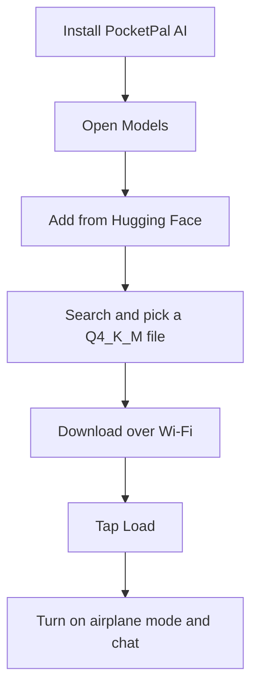
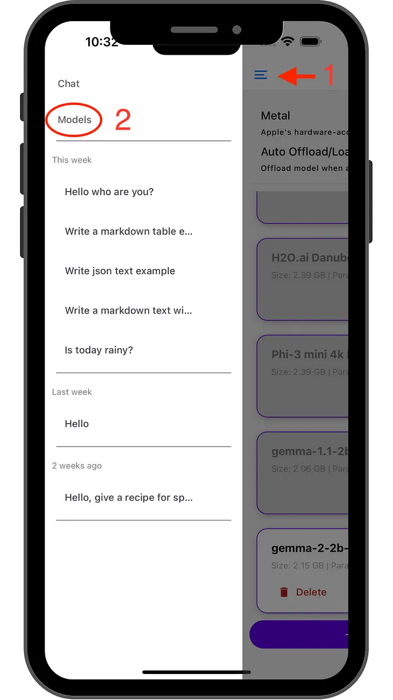
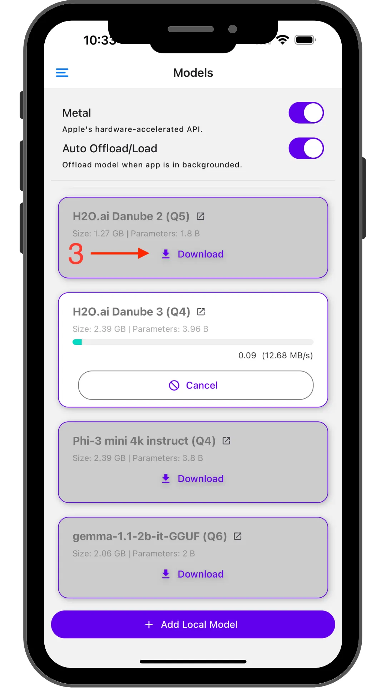
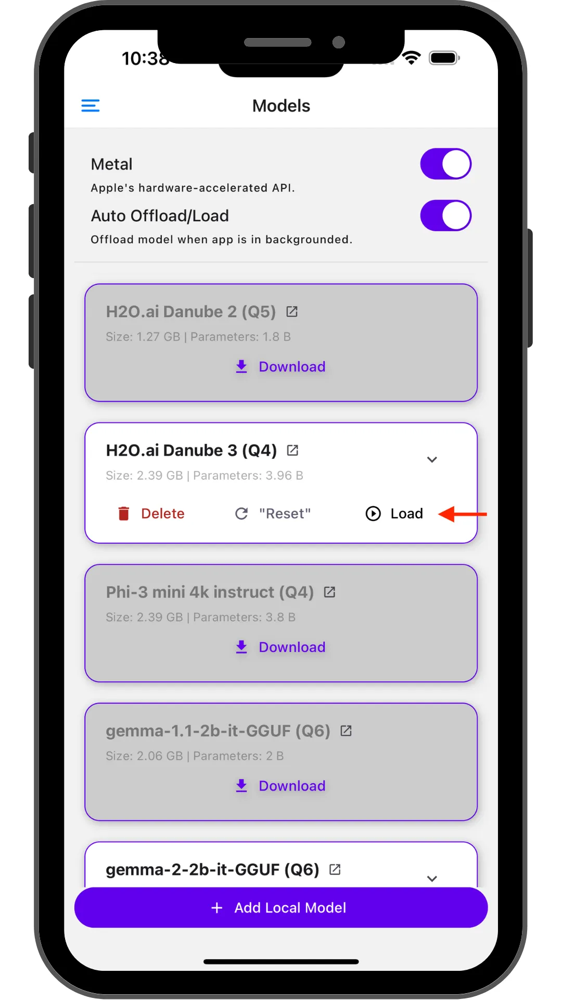
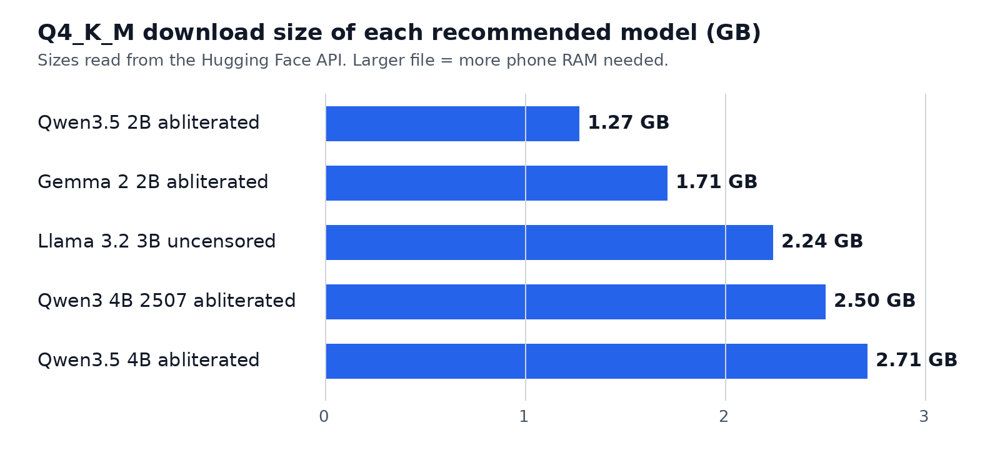

# PocketAI

Run uncensored AI fully offline on your iPhone or Android with PocketPal AI. Free, no account, and no internet after the download.

## Official links

| What | Link |
| --- | --- |
| App Store | https://apps.apple.com/us/app/pocketpal-ai/id6502579498 |
| Google Play | https://play.google.com/store/apps/details?id=com.pocketpalai |
| GitHub and APK | https://github.com/a-ghorbani/pocketpal-ai |
| Site | https://pocketpal.dev/ |

## Setup

1. Install PocketPal AI from the App Store, Google Play, or the GitHub APK.
2. Open the menu (top left) and tap Models.
3. Tap + and choose Add from Hugging Face.
4. Search for a model from the list below.
5. Download the Q4_K_M file over Wi-Fi (1 to 3 GB).
6. Tap Load when the download finishes.
7. Turn on airplane mode and start chatting.

  
  
  

Screenshots from the official PocketPal AI repository (MIT license). The Models page and Load button are the same when you add a model from Hugging Face.

## Models

Public GGUF files, no Hugging Face account needed. Start with Q4_K_M.

| Model | Q4_K_M | Link |
| --- | --- | --- |
| Huihui Qwen3.5 2B abliterated | 1.27 GB | https://huggingface.co/mradermacher/Huihui-Qwen3.5-2B-abliterated-GGUF |
| Gemma 2 2B abliterated | 1.71 GB | https://huggingface.co/bartowski/gemma-2-2b-it-abliterated-GGUF |
| Llama 3.2 3B Instruct uncensored | 2.24 GB | https://huggingface.co/bartowski/Llama-3.2-3B-Instruct-uncensored-GGUF |
| Huihui Qwen3 4B Instruct 2507 abliterated | 2.50 GB | https://huggingface.co/mradermacher/Huihui-Qwen3-4B-Instruct-2507-abliterated-GGUF |
| Huihui Qwen3.5 4B abliterated | 2.71 GB | https://huggingface.co/mradermacher/Huihui-Qwen3.5-4B-abliterated-GGUF |

Rough guidance: a phone with 6 GB of RAM or more should handle the 2B to 4B models in this list. Close other apps first.

## Troubleshooting

- The app closes or the model will not load: the file is too big for free RAM. Try a smaller model and close other apps.
- Replies are very slow: use a smaller model.
- The download keeps stopping: stay on Wi-Fi and keep the app open.

PocketPal AI is by Asghar Ghorbani, MIT license. Screenshots are copied from that repository. See [assets/CREDITS.md](assets/CREDITS.md). This repo does not host any model files.
